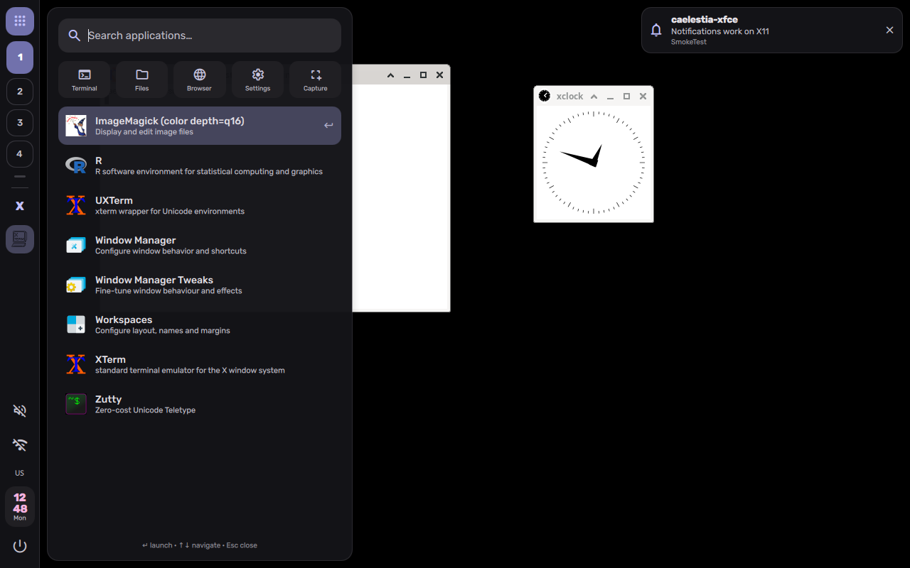

## NOTE

This is a port generated by an Agentic A.I. (used on [arena.ai](https://arena.ai)). The "workspace" can be viewed on `/Agent_AI/workspace-01a153ee-15ae-78d9-b869-c9721c021c5b.zip`.  
I gave a quick test of both versions by running `qs -p ~/.config/quickshell/caelestia-xfce/quickshell/caelestia-xfce/shell.qml`  and for what I could see, it worked for the most part.  
But if you try to actually run it, you are on your own. I am not responsible for what happens.  
I uploaded it for this repo just for future references.  


# caelestia-xfce

**A Caelestia-style [Quickshell](https://quickshell.org) desktop shell for
Xfce — specifically xfwm4 on X11.**

Upstream [Caelestia](https://github.com/caelestia-dots/caelestia) (and its
[shell](https://github.com/caelestia-dots/shell)) is built for Hyprland on
Wayland: wlr-layer-shell drawers, Hyprland IPC workspaces, the
hyprland-global-shortcuts protocol, ext-session-lock, screencopy window
previews. None of that exists on X11. This project re-implements the
Caelestia *experience* — left vertical bar, launcher/dashboard/session
drawers, notification popups, OSD, Material-3 scheme, Material Symbols
icons — on the mechanisms X11 and xfwm4 actually provide:

| Upstream (Hyprland/Wayland)        | caelestia-xfce (xfwm4/X11)                              |
|------------------------------------|---------------------------------------------------------|
| `WlrLayershell` panel + drawers    | X11 `PanelWindow` = `_NET_WM_WINDOW_TYPE_DOCK` + `_NET_WM_STRUT_PARTIAL` |
| `Quickshell.Hyprland` (`Hypr.qml`) | `services/Wm.qml` over EWMH (`xprop -spy` events + JSON snapshot script) |
| `hyprctl dispatch workspace N`     | `wmctrl -s N` / `wmctrl -i -a <win>` / `xdotool`        |
| Hyprland global shortcuts         | Xfce custom commands (`xfconf`) calling `qs ipc call`   |
| `hyprlock`-style session lock      | Delegate to `xflock4` (XSS/Xfce screensaver of your choice) |
| Hyprland blur + transparency      | xfwm4 built-in compositor, near-opaque flat surfaces    |
| `foot` terminal (Wayland-only)     | `xfce4-terminal` (configurable)                          |
| Layer rules / fullscreen layers    | Drawers auto-close when a fullscreen window is present  |

Full feature-by-feature mapping, including what was **deliberately
dropped** and why: see [PORTING.md](PORTING.md).

```
┌────┬───────────────────────────────────────────────┐
│ ▦  │  launcher drawer ──▶ ┌───────────────────┐  │   notification
│ 1  │                      │ 🔎 search…        │  │   popups (top-
│[2] │   workspaces         │  Firefox          │  │   right) ◀────
│ 3  │   (EWMH desktops)    │  Thunar           │  │
│ ─  │                      │  Terminal         │  │
│🦊 │   task list + pins   └───────────────────┘  │
│📁 │                                               │
│    │                                               │
│🔊 │   tray (SNI) · volume · network · battery ·   │
│🛜 │   keyboard layout · stacked hh/mm clock ·     │
│ 14 │   clock ──▶ dashboard drawer                  │
│ 05 │                                               │
│ ⏻  │   power ──▶ session drawer        ╭─ OSD ─╮  │
└────┴───────────────────────────────────┴───────┴──┘
```

## What you get (MVP)

- **Bar** (per screen) replacing `xfce4-panel`: workspace pills with
  occupied/urgent state, task list for the current desktop + pinned
  launchers, StatusNotifier tray, volume (scroll/click-mute), network,
  battery, keyboard layout + Caps indicator, stacked clock, power button.
  Reserves its edge via `_NET_WM_STRUT_PARTIAL` so maximised windows
  behave exactly as they did with xfce4-panel.
- **Launcher drawer**: fuzzy-ranked `.desktop` search (Quickshell
  DesktopEntries), keyboard navigation, quick actions.
- **Dashboard drawer**: date, active window (minimize/close), MPRIS
  media controls, volume/brightness sliders, CPU/memory, quick actions
  (region screenshot via `xfce4-screenshooter`, clear notifications,
  settings, lock).
- **Session drawer**: lock / suspend / log out / reboot / shut down via
  `xfce4-session-logout`, with confirm step on destructive actions.
- **Notification daemon** replacing `xfce4-notifyd`
  (`org.freedesktop.Notifications`) with actions, urgency-aware expiry.
- **OSD pill** for volume/brightness.
- **Caelestia scheme**: default Material-3 palette from upstream; if
  you already use `caelestia-cli`, its `scheme.json` is picked up live,
  so `caelestia scheme set …` recolours this shell too.
- **xfwm4 theme** (`Caelestia-Xfce`) generated in the same colours, so
  window frames match the shell.
- **Installers** that back everything up and an uninstaller that puts
  xfce4-panel back.

Known limitations are real — read [Known gaps](#known-gaps) before
replacing your panel. Most importantly: no live window previews, no
per-monitor workspaces, no blur with xfwm4's compositor, legacy XEmbed
tray icons are not bridged, and drawers don't click-outside-to-close.

## Requirements

- Xfce session on **X11** with **xfwm4** (any reasonably current Xfce)
- Arch Linux (install script target; manual install works anywhere)
- Quickshell with the **X11 panel backend** (default in `quickshell` /
  `quickshell-git` builds; CMake `X11=ON`)
- Tools the shell shells out to: `wmctrl`, `xdotool`, `xprop`,
  `xset`, `pactl` (PulseAudio or pipewire-pulse), `brightnessctl`
  (laptops), `nmcli` (network name), `python3`
- Fonts: Rubik + Material Symbols Rounded + a mono/nerd font

## Install (Arch)

```sh
git clone <this repo> caelestia-xfce   # or unpack the release tarball
cd caelestia-xfce
./install.sh --check     # verify the environment first (changes nothing)
./install.sh             # deps + config + xfwm4 tweaks + keybinds + start
```

What `install.sh` does, in order:

1. `pacman -S` the runtime tools and Quickshell (AUR
   `quickshell-git` if repos don't carry it); fonts via AUR or a
   user-local download from Google Fonts upstream.
2. Copies the Quickshell config to
   `~/.config/quickshell/caelestia-xfce/` (previous copy backed up to
   `~/.local/state/caelestia-xfce/backup-*/`).
3. Installs `~/.local/bin/caelestia-xfce-session` (session wrapper)
   and an Xfce autostart entry for it.
4. Masks `xfce4-notifyd` autostart with a user `Hidden=true` entry so
   Quickshell can own the notification D-Bus name.
5. Installs the `Caelestia-Xfce` xfwm4 theme to `~/.themes/`.
6. Applies xfwm4 settings via `xfconf-query` (compositor on, no dock
   shadows, flat opaque frames, theme + title font) — see
   `scripts/apply-xfwm4.sh`.
7. Installs keyboard shortcuts via `xfconf` custom commands that call
   `qs -c caelestia-xfce ipc call …`, recording your previous bindings
   first — see `scripts/apply-keybinds.sh`. Skip with `--no-keybinds`.
8. Starts the shell: the wrapper quits `xfce4-panel` and
   `xfce4-notifyd`, then `exec qs -c caelestia-xfce`.

> **Panel persistence:** xfce4-session may resurrect `xfce4-panel`
> from its saved session at login; the autostart wrapper kills it
> again each login (you might see it flash for a SplitParser second). For a
> flash-free setup, open *Settings → Session and Startup → Session*,
> select xfce4-panel, *Quit Program*, then *Save Session*.

### Try without committing

```sh
./install.sh --skip-packages --no-keybinds --no-start
CAELESTIA_XFCE_REPLACE_PANEL=0 QT_QPA_PLATFORM=xcb qs -c caelestia-xfce
```

…then move your existing xfce4-panel to the top edge first, otherwise
both reserve space on overlapping edges. Kill with
`qs -c caelestia-xfce kill`.

### Manual install (any distro)

1. Build Quickshell with X11 enabled (`-DX11=ON`, the default) from
   <https://quickshell.org/docs/guide/install-setup/>.
2. Install the tools listed in Requirements with your package manager.
3. `cp -r quickshell/caelestia-xfce ~/.config/quickshell/` and
   `chmod +x ~/.config/quickshell/caelestia-xfce/scripts/*.py`.
4. Put `scripts/caelestia-xfce-session.sh` on your PATH as
   `caelestia-xfce-session`, copy `autostart/` entry to
   `~/.config/autostart/` (fix `Exec=` path), mask xfce4-notifyd, and
   re-run the two `apply-*.sh` scripts inside the Xfce session.

## Keybinds

Installed by `scripts/apply-keybinds.sh` (upstream equivalents in
parentheses):

| Keys | Action |
|---|---|
| `Super+Space` | Launcher (upstream: tap Super — see note) |
| `Super+D` | Dashboard |
| `Super+Shift+S` | Session menu |
| `Super+Q` | Close focused window |
| `Super+T` / `Super+E` / `Super+W` | Terminal / Thunar / Firefox |
| `XF86Audio*` | Volume up/down/mute (with OSD) |
| `XF86MonBrightness*` | Brightness (with OSD) |
| `Super+Shift+Print` | Region screenshot |
| `Super+1…9`, `Alt+Tab`, tiling keys | **xfwm4 native** — untouched |

Single-tap Super (upstream behaviour) needs a helper on X11:

```sh
sudo pacman -S xcape
CAELESTIA_XFCE_SUPER_TAP=1 caelestia-xfce-session --restart-shell
```

All drawers/media/wm actions are also scriptable:
`qs -c caelestia-xfce ipc call drawers|sys|wm <fn>`.

## Configuration

Edit `~/.config/quickshell/caelestia-xfce/services/Config.qml`
(live-reloads): bar width, pinned apps, default terminal/browser/
editor/files, surface alpha, rounding, fonts, poll intervals, clock
format, notification timeout, volume step.

Colours: `services/Colours.qml` defaults to the stock Caelestia
scheme and live-loads `~/.local/state/caelestia/scheme.json` if
present (caelestia-cli compatible).

## Known gaps

- **No window previews/thumbnails.** X11 has no screencopy protocol;
  `_NET_WM_ICON` is a static pixmap. Tasks show theme icons
  (WM_CLASS → icon name heuristic) with a letter fallback.
- **No per-monitor workspaces.** xfwm4 desktops span all Xinerama
  screens (EWMH model). Bars on every screen show the same state;
  drawers/notifications/OSD open on the primary screen.
- **No blur** with xfwm4's built-in compositor. Surfaces use
  `surfaceAlpha ≈ 0.96`. A picom profile is on the roadmap.
- **Legacy XEmbed tray icons** (pre-SNI apps) don't appear — there is
  no XEmbed bridge. GTK3/Qt5+ SNI icons work.
- **Tray context menus**: right-click performs SNI
  `SecondaryActivate`; DBusMenu rendering is on the roadmap.
- **No click-outside-to-close** for drawers (X11 dock windows can't
  take a Wayland-style input grab). Use Esc, the toggle key or the
  bar button.
- **Notification history / sidebar, wallpaper switcher, scheme
  picker UI, lockscreen UI, area-picker overlay**: not in the MVP —
  see [PORTING.md](PORTING.md#roadmap).
  Locking uses `xflock4`, wallpapers stay with xfdesktop.

## Troubleshooting

- **Nothing appears / shell exits instantly:** read
  `~/.local/state/caelestia-xfce/shell.log`. The usual causes are a
  Quickshell built without X11 (`-DX11=OFF`) or launching under a
  Wayland session (`QT_QPA_PLATFORM` must be `xcb`; the wrapper sets it).
- **Icons show as words** ("volume_up" as text): Material Symbols font
  missing — `fc-list | grep -i material`.
- **Notifications don't show:** something else owns
  `org.freedesktop.Notifications`. Check
  `busctl --user list | grep -i notif`; make sure xfce4-notifyd is
  masked/killed (`pkill xfce4-notifyd`, then restart the shell).
- **Launcher search doesn't get keyboard focus:** xfwm4 sometimes
  refuses to focus dock-type windows. Enable *Settings → Window
  Manager → Focus → "New window focus"* / raise-on-focus, or bind the
  launcher key to a wrapper that focuses after opening:
  `qs -c caelestia-xfce ipc call drawers toggle launcher; sleep 0.15; xdotool search --name caelestia windowactivate`.
- **Bar overlaps the old panel / double reserved space:** quit
  xfce4-panel (`xfce4-panel -q`) and set xfwm4 *workspace margins*
  to 0 — struts already reserve the bar's edge.
- **Workspaces/task list look frozen:** the EWMH probe is failing.
  Run `python3 ~/.config/quickshell/caelestia-xfce/scripts/ewmh-state.py`
  — it must print one JSON line. Check `wmctrl -m` says `Name: Xfwm4`.
- **Emergency, get my desktop back:**
  `qs -c caelestia-xfce kill; xfce4-panel &` (works from a TTY with
  `DISPLAY=:0` exported).

## Uninstall

```sh
./uninstall.sh --restore-keybinds   # removes files, unmasks notifyd,
                                    # restores old shortcuts,
                                    # restarts xfce4-panel
```

Backups remain in `~/.local/state/caelestia-xfce/` for manual restore.

## Project layout

```
quickshell/caelestia-xfce/
  shell.qml                  entry point, per-screen bars, `drawers` IPC
  services/
    Wm.qml                   EWMH backend (replaces upstream Hypr.qml)
    Sys.qml                  volume/brightness/battery/network/lock keys
    Notifs.qml               org.freedesktop.Notifications server
    Colours.qml · Config.qml · ShellState.qml · TimeService.qml
  modules/bar/               Bar, Workspaces, TaskList, Tray
  modules/drawers/           Launcher, Dashboard, Session
  modules/overlays/          NotifPopups, Osd
  components/                DrawerWindow, IconButton, MaterialIcon…
  scripts/
    ewmh-state.py            xprop → JSON snapshot of desktops/windows
    sys-state.py             pactl/brightnessctl/nmcli/sysfs → JSON
scripts/                     session wrapper, xfconf apply-scripts
xfwm4/                       Caelestia-Xfce frame theme (+ generator)
install.sh · uninstall.sh
```

## Status


*From the automated smoke test — more shots in `docs/screenshots/`.*

Verified with an actual end-to-end run, not just mocks:

- The Python EWMH and system probes are unit-tested against mock
  `xprop`/`pactl`/`nmcli` output (`python3 tests/test_probes.py`),
  and a static QML checker guards the X11 port invariants
  (`python3 tests/check-qml.py`).
- The full shell has been run under **Xvfb + xfwm4 4.20** with
  **Quickshell 0.3.2** built with the X11 backend: bar struts,
  EWMH workspaces/task list, launcher, dashboard, session drawer,
  notification daemon, and `qs ipc call wm nextDesktop` /
  `drawers toggle launcher` all exercised live
  (`tests/xvfb-smoke.sh` reproduces it and screenshots the result).
- Every shell script is syntax-checked, and `install.sh`/`uninstall.sh`
  are exercised against a throwaway `$HOME`.

Not yet field-tested: a physical Arch + full Xfce session login
(xfce4-session saved-session interplay with xfce4-panel), multi-monitor
Xinerama, real PipeWire volume control, an MPRIS player actually
playing, and SNI tray menus. If something breaks there, the shell log
(`~/.local/state/caelestia-xfce/shell.log`) plus the output of the two
`scripts/*.py` probes is the fastest way to diagnose it. See
[NOTICE.md](NOTICE.md) for attribution and
[PORTING.md](PORTING.md) for the engineering notes.
